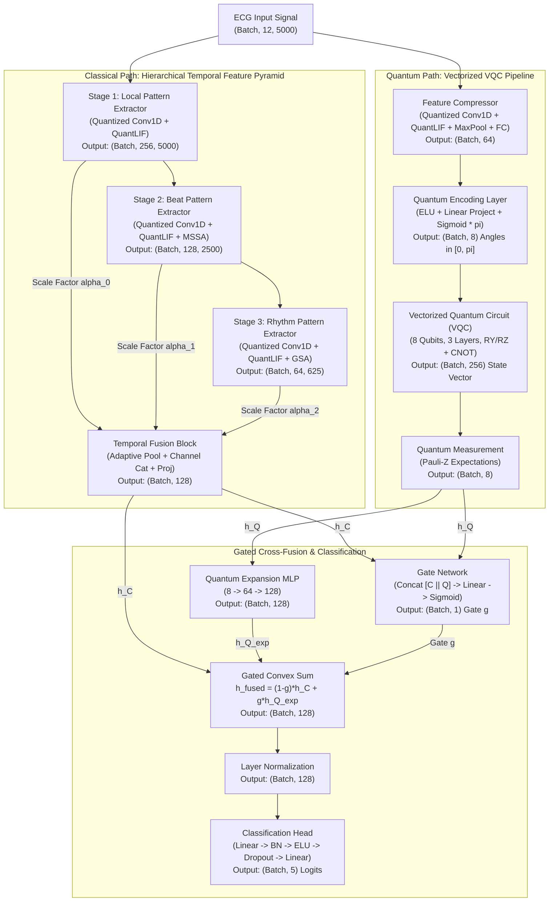

# Hybrid Quantum-Classical ECG Classification: Model V2.0 Architecture

This document provides a comprehensive technical specification of the **Hybrid Quantum-Classical ECG Classifier (Model V2.0)**. It details the mathematical foundations, tensor dimensions, component specifications, and the gated cross-fusion mechanism.

---

## 1. Architectural Overview

The V2.0 model uses a **dual-path parallel processing paradigm** to classify 12-lead ECG signals ($12 \times 5000$ inputs) into 5 diagnostic categories. It merges classical high-dimensional temporal features with quantum state spaces:



---

## 2. The Classical Path (Hierarchical Temporal Feature Pyramid)

The classical path (`ClassicalPath`) extracts temporal patterns across multiple timescales using depthwise separable convolutions with binary weights (1-bit), spiking activations, and spiking self-attention.

### Stage 1: Local Pattern Extractor (High Resolution)
Captures local morphological details (e.g., P-wave and T-wave shapes) at the original sampling rate.
* **Layers**:
  1. Depthwise 1D Convolution: kernel size = 3, stride = 1, padding = 1, groups = 12 (1-bit weights).
  2. Pointwise 1D Convolution: kernel size = 1, stride = 1 (1-bit weights).
  3. 1D Batch Normalization.
  4. Quantized LIF Spiking Activation (4 simulation timesteps).
* **Tensor Dimension Flow**: 
  $$\text{Input: } (B, 12, 5000) \longrightarrow \text{Depthwise/Pointwise} \longrightarrow (B, 256, 5000) \longrightarrow \text{QuantLIF} \longrightarrow (B, 256, 5000)$$

### Stage 2: Beat Pattern Extractor (Medium Resolution)
Captures beat-to-beat features (e.g., QRS complex shape and immediate R-R intervals).
* **Layers**:
  1. Strided Depthwise 1D Convolution: kernel size = 9, stride = 2, padding = 4, groups = 256 (1-bit weights).
  2. Pointwise 1D Convolution: kernel size = 1, stride = 1 (1-bit weights).
  3. 1D Batch Normalization.
  4. Quantized LIF Spiking Activation.
  5. Multi-Scale Spiking Attention (MSSA):
     * **Local window**: 64 timesteps.
     * **Regional dilated window**: 256 timesteps.
     * **Global pooled representation**: 16 elements.
* **Tensor Dimension Flow**:
  $$\text{Input: } (B, 256, 5000) \longrightarrow \text{Conv (Stride=2)} \longrightarrow (B, 128, 2500) \longrightarrow \text{QuantLIF} \longrightarrow (B, 128, 2500) \longrightarrow \text{MSSA} \longrightarrow (B, 128, 2500)$$

### Stage 3: Rhythm Pattern Extractor (Low Resolution)
Captures long-term arrhythmias and heart rate variability (HRV) patterns.
* **Layers**:
  1. Strided Depthwise 1D Convolution: kernel size = 27, stride = 4, padding = 13, groups = 128 (1-bit weights).
  2. Pointwise 1D Convolution: kernel size = 1, stride = 1 (1-bit weights).
  3. 1D Batch Normalization.
  4. Quantized LIF Spiking Activation.
  5. Global Spiking Attention (GSA): Single-head global self-attention.
* **Tensor Dimension Flow**:
  $$\text{Input: } (B, 128, 2500) \longrightarrow \text{Conv (Stride=4)} \longrightarrow (B, 64, 625) \longrightarrow \text{QuantLIF} \longrightarrow (B, 64, 625) \longrightarrow \text{GSA} \longrightarrow (B, 64, 625)$$

### Temporal Fusion Block
Fuses multi-scale features across all three pyramid stages.
* **Process**:
  1. **Adaptive Avg Pooling**: Stage outputs are pooled to a common sequence length $L_{\text{pool}} = 256$.
  2. **Learnable Scaling**: Stage representations are weighted via Softmax normalized parameters:
     $$\mathbf{w} = \text{Softmax}(\alpha_0, \alpha_1, \alpha_2) \in \mathbb{R}^3$$
  3. **Channel Concatenation**: Features are concatenated along the channel dimension.
  4. **Projection**: Combined features are projected to $D_{\text{fusion}} = 128$ dimensions using a 2-bit quantized convolution, followed by Batch Normalization, ELU, and Global Average Pooling.
* **Tensor Dimension Flow**:
  $$\begin{aligned}
  &S_1' = \text{AdaptivePool}(S_1) \cdot w_0 \quad \in (B, 256, 256) \\
  &S_2' = \text{AdaptivePool}(S_2) \cdot w_1 \quad \in (B, 128, 256) \\
  &S_3' = \text{AdaptivePool}(S_3) \cdot w_2 \quad \in (B, 64, 256) \\
  &F_{\text{cat}} = [S_1' \parallel S_2' \parallel S_3'] \quad \in (B, 448, 256) \\
  &h_C = \text{GlobalAvgPool}(\text{Proj}(F_{\text{cat}})) \quad \in (B, 128)
  \end{aligned}$$

---

## 3. The Quantum Path (Vectorized VQC Pipeline)

The quantum path (`QuantumPath`) projects the high-dimensional ECG signal onto an 8-qubit variational quantum circuit (VQC) using a vectorized state-vector simulator written in pure PyTorch.

### Feature Compressor
Compresses the high-dimensional signal into a low-dimensional representation to fit the qubit count.
* **Layers**:
  1. Downsampling Quantized Conv1D: channels = 12 $\to$ 64, kernel = 5, stride = 5, padding = 2.
  2. 1D Batch Normalization + QuantLIF Neuron (4 timesteps).
  3. MaxPool1D: kernel size = 16, stride = 16.
  4. Fully Connected (FC) Projection layer.
* **Tensor Dimension Flow**:
  $$\begin{aligned}
  &(B, 12, 5000) \longrightarrow \text{QuantConv1D} \longrightarrow (B, 64, 1000) \longrightarrow \text{QuantLIF} \longrightarrow (B, 64, 1000) \\
  &\longrightarrow \text{MaxPool1D} \longrightarrow (B, 64, 62) \longrightarrow \text{Flatten} \longrightarrow (B, 3968) \longrightarrow \text{FC} \longrightarrow (B, 64)
  \end{aligned}$$

### Quantum Encoding Layer
Normalizes the compressed classical features into rotation angles.
* **Projection**:
  $$\theta = \text{Sigmoid}(W_{\text{proj2}} \cdot \text{ELU}(W_{\text{proj1}} x + b_1) + b_2) \times \pi$$
  Normalizing $\theta_i \in [0, \pi]$ scales the features for quantum gate rotation without phase wrapping.
* **Tensor Dimension Flow**: $(B, 64) \longrightarrow \text{MLP} \longrightarrow (B, 8)$

### Vectorized Quantum Circuit (VQC)
An 8-qubit quantum system ($N_q = 8$, state dimension $2^8 = 256$) simulated via batched complex matrix operations.
1. **Initial State**:
   $$|\psi_0\rangle = |0\rangle^{\otimes 8} = [1, 0, 0, \dots, 0]^T \in \mathbb{C}^{256}$$
2. **Amplitude/Angle Encoding**:
   An $RY(\theta_i)$ gate is applied to each qubit $i \in \{0, \dots, 7\}$ using the input rotation angles:
   $$RY(\theta) = \begin{pmatrix} \cos(\theta/2) & -\sin(\theta/2) \\ \sin(\theta/2) & \cos(\theta/2) \end{pmatrix}$$
3. **Variational Layers ($N_L = 3$)**:
   For each layer, the following operations are applied sequentially:
   * **Parametric Rotations**: Apply $RY(\theta^{(l, 0)}_{i})$ and $RZ(\theta^{(l, 1)}_{i})$ gates to each qubit $i$ with trainable parameters $\theta$.
     $$RZ(\phi) = \begin{pmatrix} e^{-i\phi/2} & 0 \\ 0 & e^{i\phi/2} \end{pmatrix}$$
   * **Circular Entanglement**: Controlled-NOT (CNOT) gates entangle adjacent qubits in a loop:
     $$\text{Control: } q, \quad \text{Target: } (q + 1) \pmod{8} \quad \text{for } q \in \{0, \dots, 7\}$$

### Quantum Measurement
Extracts classical information from the final quantum state $|\psi_{\text{final}}\rangle$. It computes the expectation value of the Pauli-Z operator for each qubit:
$$\langle Z_i \rangle = \langle \psi_{\text{final}} | \hat{Z}_i | \psi_{\text{final}} \rangle$$
Where $\hat{Z}_i = I \otimes \dots \otimes Z \otimes \dots \otimes I$ is the Pauli-Z operator applied to qubit $i$.
* **Output Range**: $\langle Z_i \rangle \in [-1.0, 1.0]$.
* **Tensor Dimension Flow**: $(B, 256) \text{ state vector} \longrightarrow \text{Measurement} \longrightarrow h_Q \in (B, 8)$

---

## 4. The Gated Cross-Fusion Mechanism

The gated cross-fusion module (`GatedFusionModule`) dynamically balances classical temporal representations with quantum-enhanced features. Instead of using static concatenation or addition, it computes a data-dependent gating weight.

```
                  h_classical (Batch, 128)      h_quantum (Batch, 8)
                             │                          │
                             │                          ├───► Quantum Expansion (MLP)
                             │                          │     Output: h_quantum_expanded (Batch, 128)
                             ▼                          ▼
                       Concat [h_classical || h_quantum] (Batch, 136)
                                         │
                                         ▼
                                 Gate Network (MLP)
                                         │
                                         ▼
                                   Sigmoid (g) ◄─── Learned balance gate in [0, 1]
                                         │
                   ┌─────────────────────┴─────────────────────┐
                   ▼                                           ▼
                 (1 - g)                                      (g)
                   │                                           │
                   ▼                                           ▼
          (1-g) * h_classical                         g * h_quantum_expanded
                   │                                           │
                   └─────────────────────┬─────────────────────┘
                                         ▼
                                    Convex Sum
                                         │
                                         ▼
                                  LayerNorm (LN)
                                         │
                                         ▼
                                   h_fused (Batch, 128)
```

### Step 1: Quantum Feature Expansion
The low-dimensional quantum features $h_Q \in \mathbb{R}^8$ are projected into the higher-dimensional classical feature space $\mathbb{R}^{128}$ via a multi-layer perceptron with ELU activation:
$$h_{Q,\text{exp}} = W_{\text{exp2}} \cdot \text{ELU}(W_{\text{exp1}} \cdot h_Q + b_{\text{exp1}}) + b_{\text{exp2}} \quad \in \mathbb{R}^{128}$$

### Step 2: Learned Gating Network
A gating value $g \in [0, 1]$ is computed by observing both feature representations. The classical and raw quantum features are concatenated and projected to a single scalar per sample:
$$g = \sigma \Big( W_{\text{gate2}} \cdot \text{ELU}\big(W_{\text{gate1}} [h_C \parallel h_Q] + b_{\text{gate1}}\big) + b_{\text{gate2}} \Big) \quad \in \mathbb{R}^1$$
Where:
* $[h_C \parallel h_Q]$ is the concatenated vector of shape $(B, 136)$.
* $\sigma$ is the Sigmoid activation function constraining the gate value.

### Step 3: Convex Cross-Fusion & Normalization
The gate dynamically mixes the representations. A value of $g \to 0$ relies on the classical temporal pyramid, while $g \to 1$ prioritizes the quantum feature path.
$$h_{\text{fused}} = (1 - g) \odot h_C + g \odot h_{Q,\text{exp}}$$
To stabilize gradients and maintain consistent feature scales during training, layer normalization is applied to the fused vector:
$$h_{\text{final}} = \text{LayerNorm}(h_{\text{fused}}) \quad \in \mathbb{R}^{128}$$

### Step 4: Classification
The normalized fused representation is classified into 5 diagnostic classes:
$$\hat{y} = W_2 \cdot \text{Dropout}\Big(\text{ELU}\big(\text{BatchNorm1d}(W_1 h_{\text{final}} + b_1)\big)\Big) + b_2$$

---

## 5. Spiking Dynamics & Quantization Math

The model utilizes Leaky Integrate-and-Fire (LIF) spiking neurons and quantized layers to minimize computational latency.

### Spiking LIF Dynamics
The `QuantLIFNeuron` updates its state over discrete simulation timesteps $t \in \{1, \dots, T\}$ ($T = 4$):
1. **Membrane Potential Leak and Integration**:
   $$V[t] = d \cdot V[t-1] + \frac{I_{\text{input}}}{T}$$
   Where $d = \sigma(w_{\text{decay}}) \in [0, 1]$ is a learnable decay factor parameterized in logit space.
2. **Membrane Potential Quantization**:
   To prevent high-precision floating-point propagation:
   $$V_{\text{quant}}[t] = \text{Clamp}\Big(\text{Round}\big(\frac{V[t] - V_{\text{min}}}{\Delta}\big) \cdot \Delta + V_{\text{min}}, V_{\text{min}}, V_{\text{max}}\Big)$$
   Where $\Delta = \frac{V_{\text{max}} - V_{\text{min}}}{2^B - 1}$ for $B$-bit quantization ($B = 8$).
3. **Spike Generation (Heaviside step function)**:
   $$S[t] = \Theta(V_{\text{quant}}[t] - V_{\text{th}})$$
   Where $V_{\text{th}} = 1.0$ is the firing threshold.
4. **Soft Reset**:
   $$V[t] = V_{\text{quant}}[t] \cdot (1 - S[t])$$
5. **Output**: The average firing rate across timesteps is propagated as the activation:
   $$A = \frac{1}{T} \sum_{t=1}^T S[t]$$

### Surrogate Gradient Backpropagation
The derivative of the Heaviside step function $\Theta$ is zero everywhere except at the threshold, where it is undefined. To train the network using backpropagation, we use a **Fast Sigmoid Surrogate Gradient** during the backward pass:
$$\frac{\partial S}{\partial V} \approx \frac{\beta}{2(1 + \beta |V - V_{\text{th}}|)^2}$$
Where the scaling parameter $\beta = 10.0$ controls the surrogate slope.

### Straight-Through Estimator (STE)
Weight and potential quantizations use the Straight-Through Estimator to bypass non-differentiable round and sign operations:
$$W_{\text{quant}} = W_{\text{full}} + (Q(W_{\text{full}}) - W_{\text{full}}).\text{detach}()$$
During the forward pass, quantized weights are used; during the backward pass, gradients flow directly to the full-precision weights.

---

## 6. Detailed Dimension Trace Table

| Module / Layer | Operation | Input Shape | Output Shape | Parameters |
| :--- | :--- | :--- | :--- | :--- |
| **Input Signal** | Raw ECG | - | `(B, 12, 5000)` | - |
| **Stage 1 (Local)** | QuantConv1D (groups=12) | `(B, 12, 5000)` | `(B, 12, 5000)` | 36 (Binary) |
| | Pointwise Conv1D | `(B, 12, 5000)` | `(B, 256, 5000)` | 3,072 (Binary) |
| | QuantLIF Neuron | `(B, 256, 5000)` | `(B, 256, 5000)` | 1 (Decay) |
| **Stage 2 (Beat)** | QuantConv1D (groups=256) | `(B, 256, 5000)` | `(B, 256, 2500)` | 2,304 (Binary) |
| | Pointwise Conv1D | `(B, 256, 2500)` | `(B, 128, 2500)` | 32,768 (Binary) |
| | QuantLIF + MSSA | `(B, 128, 2500)` | `(B, 128, 2500)` | Attention params |
| **Stage 3 (Rhythm)**| QuantConv1D (groups=128) | `(B, 128, 2500)` | `(B, 128, 625)` | 3,456 (Binary) |
| | Pointwise Conv1D | `(B, 128, 625)` | `(B, 64, 625)` | 8,192 (Binary) |
| | QuantLIF + GSA | `(B, 64, 625)` | `(B, 64, 625)` | Attention params |
| **Temporal Fusion** | Adaptive Pool + Cat | Stage 1, 2, 3 outputs | `(B, 448, 256)` | - |
| | Projection Conv1D | `(B, 448, 256)` | `(B, 128, 256)` | 57,344 (2-bit) |
| | Global Avg Pool | `(B, 128, 256)` | `(B, 128)` | - |
| **Feature Compressor**| QuantConv1D (stride=5) | `(B, 12, 5000)` | `(B, 64, 1000)` | 3,840 (Binary) |
| | QuantLIF + MaxPool | `(B, 64, 1000)` | `(B, 64, 62)` | 1 (Decay) |
| | Flatten + FC Proj | `(B, 3968)` | `(B, 64)` | 254,016 (FP32) |
| **Quantum Encoding** | MLP Projection | `(B, 64)` | `(B, 8)` | 2,344 (FP32) |
| **Vectorized VQC** | RY Angle Encoding | `(B, 8)` | `(B, 256)` | - |
| | 3 Variational Layers | `(B, 256)` | `(B, 256)` | 48 (FP32) |
| **Measurement** | Pauli-Z Expectation | `(B, 256)` | `(B, 8)` | - |
| **Gated Fusion** | Quantum Exp MLP | `(B, 8)` | `(B, 128)` | 1,216 (FP32) |
| | Gating Net MLP | Concat `(B, 136)` | `(B, 1)` | 8,833 (FP32) |
| | Convex Sum + LN | `h_C`, `h_Q_exp`, `g` | `(B, 128)` | 256 (FP32) |
| **Classifier** | Linear MLP Head | `(B, 128)` | `(B, 5)` | 8,645 (FP32) |

---

## 7. Crucial Implementation Bugs & Performance Bottlenecks

During detailed code audit, we identified the following critical issues that cause model training failures, silent gradient termination, or excessive CPU memory consumption:

> [!CAUTION]
> ### 1. Zero Gradient Flow in LIF Neuron (`quantized_layers.py`)
> **Line 256** uses standard thresholding to fire spikes:
> ```python
> spike = (v >= self.threshold).float()
> ```
> While `_surrogate_spike()` is defined with the Fast Sigmoid gradient, **it is never called** in the forward loop. As a result, the PyTorch autograd graph treats the spiking step as step-wise constant, yielding **zero gradients** for all previous quantized convolutional layers.
> * **Fix**: Change line 256 to call `self._surrogate_spike(v)`.

> [!WARNING]
> ### 2. Runtime Unpacking Crash (`classical_path.py` vs `quantized_layers.py`)
> * `QuantLIFNeuron.forward` returns **4 values**: `spike_rate, v, reg_loss, additional_metrics`.
> * Callers in `classical_path.py` (e.g., **line 76**) only unpack **3 values**:
>   ```python
>   x, _, reg_loss = self.lif(x, timesteps=self.timesteps)
>   ```
> This causes an immediate execution crash: `ValueError: too many values to unpack (expected 3)`.
> * **Fix**: Update the extraction code in the Classical Path and Compressor layers to handle the fourth metric dictionary or adjust the return signature.

> [!WARNING]
> ### 3. In-Place Tensor Mutation Breaks Autograd (`quantum_circuit.py`)
> In the CNOT application function `_apply_cnot()`, the tensor is mutated in-place:
> ```python
> state[tuple(idx_c1_t0)] = state_c1_t1
> state[tuple(idx_c1_t1)] = state_c1_t0
> ```
> Modifying `state` in-place breaks PyTorch's autograd graph history tracking, leading to errors when calling `.backward()` during training.
> * **Fix**: Re-allocate a new state tensor instead of modifying it in-place.

> [!NOTE]
> ### 4. Extremely Inefficient Pauli-Z Matrix Multiplications (`quantum_circuit.py`)
> The expectation value uses a full $256 \times 256$ complex matrix-vector multiplication for each of the 8 qubits:
> ```python
> obs_state = torch.matmul(obs, state.T).T
> ```
> Since the Pauli-Z observable tensor $\hat{Z}_i$ is diagonal and contains only $\{1, -1\}$, this can be computed using element-wise multiplication with a precomputed indexing bit-mask, reducing operations from $\mathcal{O}(2^N \times 2^N)$ to $\mathcal{O}(2^N)$.
> * **Fix**: Vectorize expectations by extracting diagonal values and performing element-wise matrix ops.
